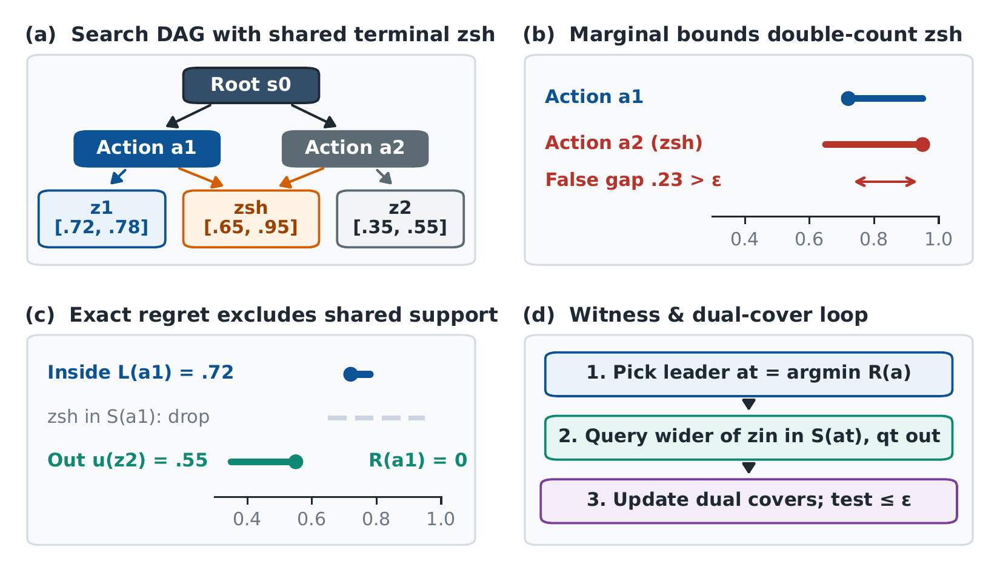

# Shared-Support and Bayesian Certification in Monte Carlo Search Graphs (`dag-cert`)

[](LICENSE)
[](requirements-full.txt)
[](manuscript/DAG_Cert_manuscript.pdf)

Official research codebase, datasets, independent numerical-oracle audits, and end-to-end reproduction suite for **Shared-Support and Bayesian Certification in Search Graphs** ([Manuscript PDF](manuscript/DAG_Cert_manuscript.pdf)).

<p align="center">
  
</p>

- **Manuscript (compiled PDF):** [`manuscript/DAG_Cert_manuscript.pdf`](manuscript/DAG_Cert_manuscript.pdf)
- **Zero workstation dependencies:** all paths are repository-relative, all compact benchmark matrices (`dag_mcts/data/`, 1.7 MB) are bundled for immediate offline CPU reproduction, and [`scripts/fetch_data.py`](scripts/fetch_data.py) downloads and rebuilds every external upstream dataset and Hugging Face model from public sources on any machine.

---

## What This Work Does

In Monte Carlo graph search, combinatorial experimental design (e.g., protein mutagenesis), and multi-stage LLM workflow tuning, an agent must commit to an initial root action $a \in \mathcal{A}$ in a finite DAG where distinct root actions can lead to **overlapping sets of terminal outcomes** (and where terminal rewards may be **correlated** or observed under **unknown heterogeneous noise**).

Standard best-arm identification and conventional Bayesian optimization either waste evaluations trying to identify a unique winning *terminal leaf* or rely on conservative marginal intervals that ignore shared downstream outcomes. This work unifies the statistical and computational foundations of **root-action certification** around one structural principle:

> **One Invalidating Alternative.** Action $a$ is strictly $\varepsilon$-optimal at confidence $1-\delta$ if and only if no single outcome outside $a$'s reachable support can exceed every continuation reachable from $a$ by more than $\varepsilon$ inside the active confidence set.

### Core Contributions Implemented in This Repository

1. **Exact Shared-Support Root Certification & Trajectory-Coupled Certification (TCC)** (`dag_mcts/v2_monitors.py`, `dag_mcts/v5_hybrid_and_os.py`):
   - Cancels uncertainty on shared downstream outcomes, achieving up to **18.4× fewer evaluations** than marginal-interval certification in overlapping DAGs.
   - Separates *optimization* from *decision certification*: standard GP acquisitions (`GP-UCB`, `GP-Thompson`) find an $\varepsilon$-optimal GB1 protein variant in ~50 assays yet certify **0%** within a 45k cap, whereas root-aware witness refinement certifies **100%**.
   - Provides $O(\log M)$-update **Dual Witness Covers** (`DualWitnessCovers`), parameter-free **Optimistic Separation (`OS`)**, protected/decision-selective retirement, and native `-O3` C++17 micro-kernels (`dag_mcts/_cpp_kernels.cpp`).

2. **Correlation-Aware Conic Regret & Information-Optimal Tracking** (`dag_mcts/v7_bayesian_ucd.py`, `dag_mcts/v8_unified_experiments.py`):
   - Computes exact worst-case regret over ellipsoidal confidence sets via **simplicial Carathéodory column generation** ($|\operatorname{supp}(p^*)| \le d+1$) with lazy challenger pruning and provably sound amortized schedules (**10–140 µs** break-even vs. independent `OS`).
   - Implements **Regularized Decision-Aware Information Tracking**, approaching the sharp characteristic-time rate $I_*(\theta)^{-1}\log(1/\delta)$ (**2.0×–2.6×** fewer samples than heuristic contrast-directed sampling on proxy/tied graphs).
   - Explicitly separates **formal distribution-free (`DF`)**, **valid bounded-residual ($|b|\le\xi$)**, and **empirically calibrated model-based (`Calibrated EB+LOO`)** stopping rules, verified by coupled-stream ablations and pointwise vs. decision-level coverage diagnostics.

3. **Unknown Heterogeneous Gaussian Variances (V34 Adaptive Tracker)** (`dag_mcts/v9_v34_tracker.py`, `dag_mcts/_cpp_v34_bnb.cpp`):
   - Combines **sparse four-power global design refreshes** ($\mathcal{S}=\{1,4,16,64,\dots\}$) with **action-local predictably skipped evidence**, cutting component-null solves **68.7×** and wall time **50.4×** at $K=64$ while preserving the discovery-plus-rate bound $D_s + (1+s)C_*^{-1}\log(1/\delta)$.
   - Ships a native `-O3 -std=c++17` outward-certified Branch-and-Bound + Dual-QP solver (**31×–82×** faster than Python; certifies $d=6, K=16$ in `577 ms` and scales to $d=8$ in `2.7 s`), avoiding the **183/200** local-SLSQP violations on bimodal Behrens–Fisher nulls.

4. **Zero-Shared-Code Independent Numerical-Oracle Verification** (`paper/exp_v11_3_independent_oracle_audit.py`):
   - Independently audits every core solver against direct `CVXPY` SOCPs/QPs, `SciPy differential_evolution` + dense boundary grids + 50-digit `decimal` arithmetic, 100,000-draw null-boundary supermartingale checks, and brute-force DAG dynamic programming (**5/5 PASS**, zero soundness or coverage violations).

### Headline Empirical Summary

| Regime / Benchmark | Method & Validity Tier | Key Result |
|---|---|---|
| Controlled overlap DAGs | `Exact-Regret OS` *(Formal DF)* vs. marginal | Up to **18.4×** fewer observations, 0 errors |
| Raw GB1 ($n=200$) & TmTrpB ($n=210$) proteins | `OS` *(Formal DF)* / `Rob. .005` *(Valid $\|b\|\le\xi$)* / `EB+LOO` *(Model-based)* | `13.9k`/`16.3k` (`100%`) $\to$ `10.6k`/`15.4k` $\to$ **`2.9k`/`4.4k`** (**3.7×–4.8×**, 0/410 err; strict DF confirmation: 0.90×–0.97×) |
| Projected heteroscedastic GB1 ($n=160$) | `V34-Full (C++)` *(Exact linear Gauss.)* vs. `Student-t OS` | **287** vs. `40,000*` median assays (**>139×**, 0/160 err); honest raw-landscape misspecification boundary (`40%` V34 err vs. `0/160` `EB+LOO`) |
| Uncached live `Qwen3-0.6B` WorFBench (36 campaigns, 4 domains, cap 60) | `OS` & `EB+DF` *(Formal DF)* vs. `Calibrated EB+LOO` *(Model-based)* | `0/36` (`0%`) vs. **`36/36` (`100%`, 9/9 per domain)** in **24.0** evals / **14.3k** fresh tokens (`0.002%` conic compute, untouched $D_{\mathrm{test}}$ reg. `0.0126`) |
| Independent Oracle Audit (`v11_3`) | Zero-shared-code reference solvers | **5/5 PASS**: `0/200` SOCP, `0/100` QP, `0/700` B&B, `0/5` MC supermartingale, `0/20,000` DP mismatches |

---

## Quickstart (Any Machine)

Tested on **Python 3.12 / 3.13** (Linux & macOS; pure-Python paths also run on Windows).

### 1. Clone and install dependencies

```bash
git clone https://github.com/AI-MathPhys/dag-cert.git
cd dag-cert

python3 -m venv .venv
source .venv/bin/activate   # Windows PowerShell: .\.venv\Scripts\Activate.ps1

# Core + all v1--v11 CPU experiments, figures, tests, data fetchers, and CVXPY audits:
python -m pip install -r requirements-full.txt
```

Optional extras:
- **Live uncached `Qwen3-0.6B` LLM workflows (`v8_5`, `v10_3`, `v11_2`)**:
  ```bash
  python -m pip install -r requirements-live-llm.txt
  ```
- **Native `-O3` C++17 kernels** (`exp7`, SameGame playouts, and V34 B&B in `v9`/`v10`/`v11_3`): requires `g++` or `clang++` (auto-detected via `$CXX`, `g++`, or `clang++`; e.g. `sudo apt install g++` on Ubuntu/Debian or `xcode-select --install` on macOS).
- **Minimal frozen v1 CI environment only**: `python -m pip install -r requirements.lock` (preserved byte-identical for `reproduce.py verify`).

### 2. Verify installation, data integrity, and unit tests (~1 min)

```bash
# Check bundled datasets, optional HF cache, and C++17 compiler:
python scripts/fetch_data.py --check

# Verify SHA-256 manifests across ALL archived experiments (v1--v11):
python -B reproduce.py verify
python -B reproduce_extensions.py verify
python -B reproduce_bayesian_ucd.py verify

# Run ALL 72 unit tests (23 v1 + 25 v2--v6 + 24 v7--v11):
python -B reproduce_extensions.py test
python -B reproduce_bayesian_ucd.py test

# Run a minimal 4-method coupled certification demo:
python -B examples/certify.py
```

---

## Fetching & Rebuilding External Data (`scripts/fetch_data.py`)

To make reproduction fast and offline-friendly, the four compact preprocessed `.npz` archives (`dag_mcts/data/`, 1.7 MB total) and the 20-board SameGame set (`appendix/data/samegame/StandardTestset.txt`) are already included in Git (no Git LFS required).

Anyone can **freshly download every upstream public dataset and model** and rebuild the local archives from scratch using [`scripts/fetch_data.py`](scripts/fetch_data.py):

| Dataset / Asset | Upstream Public Source | Bundled File | Rebuild Command |
|---|---|---|---|
| **GB1** (149,361 4-site variants, Wu et al., eLife 2016) | [FLIP GitHub](https://github.com/J-SNACKKB/FLIP) (`four_mutations_full_data.csv.zip`) | `dag_mcts/data/gb1_wu2016_measured.npz` | `python scripts/fetch_data.py --proteins` |
| **TmTrpB** (159,129 4-site variants, Johnston et al., PNAS 2024) | [Zenodo 15203754](https://zenodo.org/records/15203754) (Arnold Lab SSMuLA) | `dag_mcts/data/trpb_johnston2024_measured.npz` | `python scripts/fetch_data.py --proteins` |
| **WorFBench** raw trajectories (4 domains) | [zjunlp/WorfBench](https://github.com/zjunlp/WorfBench) (`gold_traj/*/graph_eval.json`) | Auto-cached to `dag_mcts/data/worfbench_raw/` | `python scripts/fetch_data.py --worfbench-tasks` |
| **Qwen3-0.6B** & **Qwen3-Embedding-0.6B** | Hugging Face Hub (`Qwen/Qwen3-0.6B`, `Qwen/Qwen3-Embedding-0.6B`) | Local HF cache (`~/.cache/huggingface`) | `python scripts/fetch_data.py --models` |
| **WorFBench** 81×64 & 81×32 scored matrices | Generated from raw WorFBench + Qwen3-0.6B | `dag_mcts/data/worfbench_qwen3_*.npz` | `python scripts/fetch_data.py --rebuild-worfbench` |

Common fetch workflows:

```bash
# 1. Inspect bundled archives, raw caches, HF models, and C++17 compiler:
python scripts/fetch_data.py --check

# 2. Download raw GB1 & TmTrpB archives and rebuild .npz into an isolated directory to compare:
python scripts/fetch_data.py --proteins --out-dir build/rebuilt_data

# 3. Download raw GB1, TmTrpB, all 4 WorFBench domains, AND pre-cache Qwen3-0.6B models from HF:
python scripts/fetch_data.py --all

# 4. (Optional, slow on CPU) Regenerate the 81x64 and 81x32 WorFBench Qwen3 score matrices from scratch:
python scripts/fetch_data.py --rebuild-worfbench
```

> **Note on offline execution:** By default, live LLM scripts auto-download `Qwen/Qwen3-0.6B` and `Qwen/Qwen3-Embedding-0.6B` on first use and reuse the Hugging Face cache thereafter. Set `HF_HUB_OFFLINE=1` after running `python scripts/fetch_data.py --worfbench-tasks --models` to enforce strictly air-gapped execution.

---

## Reproducing the Paper

The codebase provides three top-level reproduction CLIs covering every result in the manuscript without overwriting frozen archives during verification or smoke testing:

1. **`reproduce.py`** — Frozen v1 UCT archive (1,920 runs, 3.83M rollout-boundary replay, historical appendix).
2. **`reproduce_extensions.py`** — v2–v6 independent-terminal, PUCT, Empirical Bernstein, active `DAG-LUCB`, C++17 micro-kernels, external structured-BAI baselines, SameGame, and Bayesian optimization suites (`exp1`–`exp15`).
3. **`reproduce_bayesian_ucd.py`** — v7–v11 correlation-aware Bayesian certification (`e0`–`e6`), unified validation (`v8_1`–`v8_6`), unknown-variance V33/V34 (`v9_1`–`v9_4`), native C++17 B&B & real heteroscedastic bridge (`v10_1`–`v10_3`), and pre-submission audits (`v11_1`–`v11_3`).

### Fast Verification, Summaries & Figures (Minutes, CPU-Only)

```bash
# 1. Full v1 quickcheck (checksums, 23 tests, tables, UCT + historical figures -> build/):
python -B reproduce.py quickcheck

# 2. Regenerate ALL summary CSVs from archived JSONL logs:
python -B reproduce_extensions.py summaries
python -B reproduce_bayesian_ucd.py summaries

# 3. Regenerate ALL publication PDF figures (into build/figures or results/*/figures):
python -B reproduce_extensions.py figures --out build/figures_ext
python -B reproduce_bayesian_ucd.py figures --out build/figures_bayesian

# 4. Run fast smoke tests across individual suites (writes safely to OS tempdir, never clobbers results/):
python -B reproduce.py benchmark --smoke --out build/smoke-v1
python -B reproduce_extensions.py benchmark --smoke --only exp11
python -B reproduce_bayesian_ucd.py benchmark --smoke --only v11_3
python -B reproduce_bayesian_ucd.py benchmark --smoke --only v11_1
```

### Mapping Paper Sections, Tables & Figures to Exact Experiment Commands

| Paper Section / Artifact | Suite Key | Command to Re-run From Scratch | Typical Hardware & Notes |
|---|---|---|---|
| **Sec. 2–3, Fig. 1–2**: Exact regret, PUCT, SameGame, Emp. Bernstein, active `DAG-LUCB`, C++17 kernels, external baselines (`LUCB-micro`, `UGapE-MCTS`, `VarDE-DAG`), `OS`, BO | `exp1`–`exp15` | `python -B reproduce_extensions.py benchmark` (or `--only exp11`) | Multi-core CPU + `g++`/`clang++` |
| **Sec. 3.1, App. O**: Correlation-aware conic regret, phase diagram, proxy/hull geometry, initial protein/WorFBench, scaling | `e0`–`e6` | `python -B reproduce_bayesian_ucd.py benchmark --only e1` (for each of `e0`..`e6`) | CPU (`cvxpy` required for `e0`/`e2`) |
| **Sec. 3.1, Fig. 3–4, App. O**: Calibrated proteins + rough-GP cure + $(\xi,\varepsilon)$ frontier (`v8_1`), Info-Tracking vs. `CD-Joint` (`v8_2`), deconfounded $4\times 4\times 3$ factorial (`v8_3`), amortized conic break-even (`v8_4`), hard SameGame (`v8_6`) | `v8_1`–`v8_4`, `v8_6` | `python -B reproduce_bayesian_ucd.py benchmark --only v8_2` | Multi-core CPU (auto-scales `--workers`) |
| **Sec. 3.1–3.2, Fig. 3, App. P**: Unknown-variance V34 vs. V33 sparse refresh (`v9_1`), heteroscedastic efficiency (`v9_2`), switching/IUT/Behrens–Fisher safety (`v9_3`), certified B&B cost (`v9_4`) | `v9_1`–`v9_4` | `python -B reproduce_bayesian_ucd.py benchmark --only v9_1` | Multi-core CPU + `g++`/`clang++` |
| **Sec. 3.2, Table 2, App. Q**: Native C++17 B&B scaling to $d=8$ (`v10_1`) & real heteroscedastic GB1/WorFBench bridge (`v10_2`) | `v10_1`, `v10_2` | `python -B reproduce_bayesian_ucd.py benchmark --only v10_1` | Multi-core CPU + `g++`/`clang++` |
| **Sec. 3.1, Table 2, App. R (Table 52, Fig. 9a–b)**: P0 real-data validity ablation & coupled-stream replay (GB1 $n=200$, TmTrpB $n=210$) | `v11_1` | `python -B reproduce_bayesian_ucd.py benchmark --only v11_1` | Multi-core CPU (~20 min on 16 cores) |
| **Sec. 3.1, Table 2, App. R (Table 53, Fig. 9c)**: P1 36-campaign 4-domain uncached live `Qwen3-0.6B` WorFBench replication (also `v8_5`, `v10_3`) | `v11_2` (`v8_5`, `v10_3`) | `python -B reproduce_bayesian_ucd.py benchmark --only v11_2` | Requires `requirements-live-llm.txt`; supports `--smoke`, `--max-concurrent`, `--threads-per-worker`, and automatic checkpoint resume |
| **App. R (Table 54)**: P2 Zero-shared-code independent numerical-oracle verification audit (`5/5 PASS`) | `v11_3` | `python -B reproduce_bayesian_ucd.py benchmark --only v11_3` | Single/multi-core CPU (~4.5 min full, ~15 s `--smoke`); requires `cvxpy` + `g++`/`clang++` |
| **v1 UCT Trajectory Replay** (3,826,797 rollout boundaries) | `v1` | `python -B reproduce.py replay --study all --out build/replay-01` | CPU-only, exact decision & work replay |

> **Tip for running a custom output directory:** Individual experiment scripts under `paper/exp_v8_*.py` through `paper/exp_v11_*.py` all accept `--out-dir <path>`, `--smoke`, `--summarize-only`, and `--workers <N>` (defaulting automatically to your machine's CPU count), so you can re-run any experiment into `build/...` without modifying the archived `results/` manifests.

---

## Repository Structure

```text
graph-search-certification/
├── dag_mcts/                       # Core library (Python + native C++17 kernels + bundled data)
│   ├── graph.py                    # Finite all-MAX DAG and terminal reward streams
│   ├── retired_bounds.py           # Canonical confidence intervals & strict retirement
│   ├── v2_monitors.py              # Hoeffding & Emp. Bernstein boxes, charged dual covers, exact regret
│   ├── v3_extensions.py            # Active Exact-Regret-DAG-LUCB & C++17 ctypes bridge
│   ├── v4_baselines.py             # LUCB-micro, UGapE-MCTS, VarDE-DAG, SameGame & routing benchmarks
│   ├── v5_hybrid_and_os.py         # O(log M) DualWitnessCovers, Safeguarded-LCB, Optimistic Separation
│   ├── v6_real_world.py            # Flat-LUCB controls, GB1, TmTrpB, and WorFBench problem interfaces
│   ├── v6_bayesian_opt.py          # Woodbury GP surrogate, GP-UCB/EI/TS/Root-Info, RKHS ellipsoids
│   ├── v7_bayesian_ucd.py          # Exact SOCP conic regret, Carathéodory colgen, T5 rate solver
│   ├── v8_unified_experiments.py   # Calibrated EB+LOO GP, bounded-residual hybrid, Info-Tracking
│   ├── v9_v34_tracker.py           # Unknown-variance V33/V34 tracker, rank-2 cubic & C++17 B&B bridge
│   ├── _cpp_kernels.cpp            # Native -O3 C++17 DAG maintenance kernels
│   ├── _cpp_samegame.cpp           # Native -O3 C++17 SameGame playout kernel
│   ├── _cpp_v34_bnb.cpp            # Native -O3 C++17 outward-certified B&B + Dual-QP solver
│   └── data/                       # Bundled compact benchmark .npz files (1.7 MB total)
├── scripts/
│   └── fetch_data.py               # Portable CLI to check, download, & rebuild all external data/models
├── paper/                          # Experiment runners (exp_*.py), dataset builders, & figure plotters
├── tests/                          # 72 unit, parity, theoretical, and oracle tests (test_*.py)
├── examples/
│   └── certify.py                  # Minimal self-contained 4-method certification example
├── results/                        # SHA-256-verified archived logs, CSV summaries, & manifests (v1--v11)
├── appendix/                       # Isolated historical pricing/controller archive (see REPRODUCIBILITY.md)
├── reproduce.py                    # Frozen v1 UCT archive verifier, replayer, & timing CLI
├── reproduce_extensions.py         # v2--v6 verification, testing, plotting, & benchmark CLI
├── reproduce_bayesian_ucd.py       # v7--v11 verification, testing, plotting, & benchmark CLI
├── requirements-full.txt           # Full CPU dependencies (v1--v11 experiments, figures, CVXPY audits)
├── requirements-live-llm.txt       # Optional PyTorch/Transformers extras for live Qwen3-0.6B suites
├── requirements.txt / .lock        # Frozen minimal v1 CI dependencies (hashed by artifact_manifest.json)
├── REPRODUCIBILITY.md              # Detailed archival verification contracts & v1--v11 artifact map
└── VALIDATION.md                   # Frozen v1 protocol notes
```

---

## Interpretation & Statistical Scope

- **Validity tiers are explicit and never conflated:** `[0, 1]`-bounded Empirical Bernstein / Hoeffding intervals are formally distribution-free (`Formal DF`); `Student-t OS` and `V34` rely on Gaussian linear-feature assumptions; bounded-residual `Rob.` / `Hybrid` require a misspecification bound $|b|\le\xi$; and `Calibrated EB+LOO` is **empirically calibrated / model-based (not formally distribution-free)** unless confirmed by a formal DF certificate (see Table 1 and Appendix R of the paper).
- **Protein experiments** use retrospective simulated noisy assay replicates on experimentally measured combinatorial landscapes (Wu et al. 2016 GB1; Johnston et al. 2024 TmTrpB); **live LLM experiments** execute fresh uncached `Qwen3-0.6B` + `Qwen3-Embedding-0.6B` forward passes on strictly disjoint unseen WorFBench task pools.
- **Timing reproducibility:** Wall-clock timings and wall-capped completion counts naturally depend on host CPU hardware; statistical trajectories, exact operation counts, and SHA-256 verification manifests are deterministic across machines.

See [`REPRODUCIBILITY.md`](REPRODUCIBILITY.md) for the complete artifact-to-manuscript verification map and historical appendix instructions.
